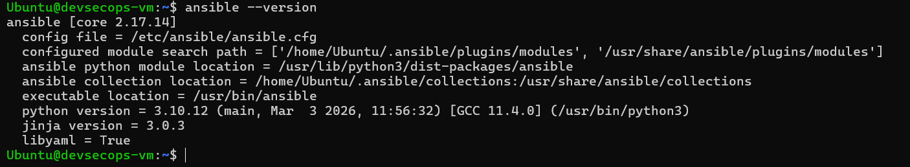
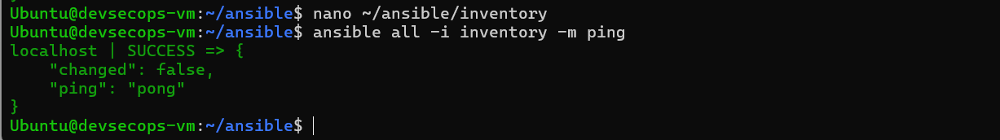
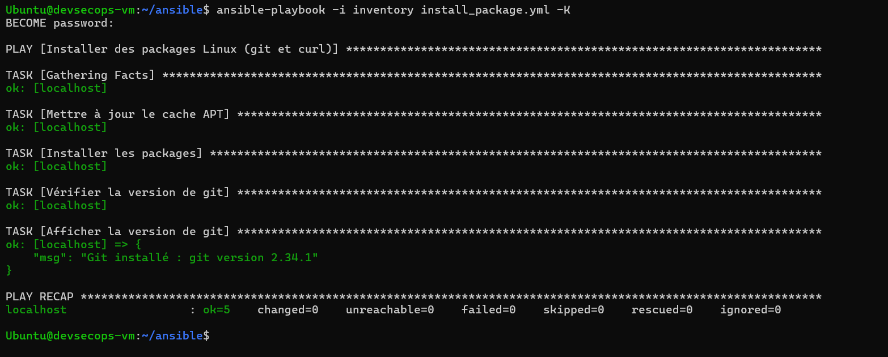
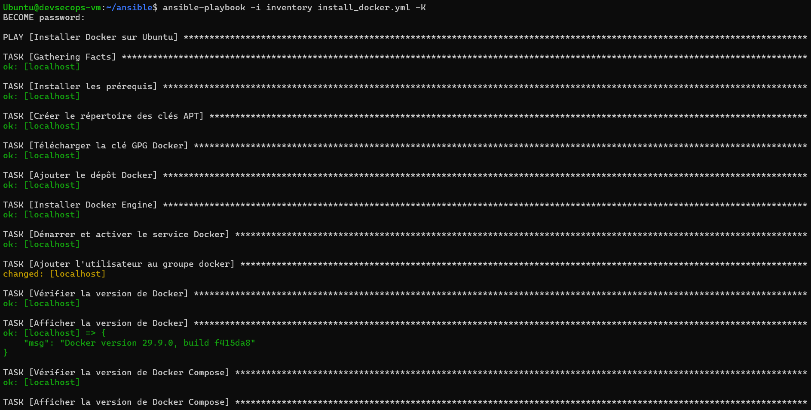

# Activité — Automatisation avec Ansible

**Étudiant :** Narjess Dabbech  
**VM Administration :** devsecops-vm (Ubuntu 22.04)  
**Date :** 15/10/2026

---

## VII. Automatisation avec Ansible

### 25. Installation d'Ansible

**Commandes exécutées :**

```bash
sudo apt update
sudo apt install -y software-properties-common
sudo add-apt-repository --yes --update ppa:ansible/ansible
sudo apt install -y ansible
ansible --version
```

**Résultat :**

```
ansible [core 2.17.14]
  config file = /etc/ansible/ansible.cfg
  ...
  python version = 3.10.12
  jinja version = 3.0.3
  libyaml = True
```

**Capture d'écran :**



---

### 26. Inventory et test de communication

**Fichier `inventory` :**

```ini
[ubuntu_servers]
localhost ansible_connection=local ansible_python_interpreter=/usr/bin/python3
```

**Commande :**

```bash
ansible all -i inventory -m ping
```

**Résultat :**

```
localhost | SUCCESS => {
    "changed": false,
    "ping": "pong"
}
```

**Capture d'écran :**



---

### 27. Playbook d'installation de packages

**Fichier `install_package.yml` :**

```yaml
---
- name: Installer des packages Linux (git et curl)
  hosts: ubuntu_servers
  become: yes
  vars:
    packages:
      - git
      - curl
  tasks:
    - name: Mettre à jour le cache APT
      apt:
        update_cache: yes
        cache_valid_time: 3600
    - name: Installer les packages
      apt:
        name: "{{ packages }}"
        state: present
    - name: Vérifier la version de git
      command: git --version
      register: git_version
      changed_when: false
    - name: Afficher la version de git
      debug:
        msg: "Git installé : {{ git_version.stdout }}"
```

**Commande :**

```bash
ansible-playbook -i inventory install_package.yml -K
```

**Résultat :**

```
PLAY RECAP ************************************************************
localhost : ok=5  changed=0  unreachable=0  failed=0  skipped=0

"msg": "Git installé : git version 2.34.1"
```

**Remarque :** `changed=0` illustre l'**idempotence** d'Ansible.

**Capture d'écran :**



---

### 28. Playbook d'installation de Docker

**Fichier `install_docker.yml` :**

```yaml
---
- name: Installer Docker sur Ubuntu
  hosts: ubuntu_servers
  become: yes
  tasks:
    - name: Installer les prérequis
      ansible.builtin.apt:
        name:
          - ca-certificates
          - curl
          - gnupg
          - lsb-release
        state: present
        update_cache: yes
    - name: Créer le répertoire des clés APT
      ansible.builtin.file:
        path: /etc/apt/keyrings
        state: directory
        mode: '0755'
    - name: Télécharger la clé GPG Docker
      ansible.builtin.get_url:
        url: https://download.docker.com/linux/ubuntu/gpg
        dest: /etc/apt/keyrings/docker.asc
        mode: '0644'
    - name: Ajouter le dépôt Docker
      ansible.builtin.apt_repository:
        repo: "deb [arch=amd64 signed-by=/etc/apt/keyrings/docker.asc] https://download.docker.com/linux/ubuntu {{ ansible_distribution_release }} stable"
        state: present
        filename: docker
    - name: Installer Docker Engine
      ansible.builtin.apt:
        name:
          - docker-ce
          - docker-ce-cli
          - containerd.io
          - docker-buildx-plugin
          - docker-compose-plugin
        state: present
        update_cache: yes
    - name: Démarrer et activer le service Docker
      ansible.builtin.service:
        name: docker
        state: started
        enabled: yes
    - name: Ajouter l'utilisateur au groupe docker
      ansible.builtin.user:
        name: "{{ ansible_user_id }}"
        groups: docker
        append: yes
    - name: Vérifier la version de Docker
      ansible.builtin.command: docker --version
      register: docker_version
      changed_when: false
    - name: Afficher la version de Docker
      ansible.builtin.debug:
        msg: "{{ docker_version.stdout }}"
```

**Commande :**

```bash
ansible-playbook -i inventory install_docker.yml -K
```

**Résultat :**

```
PLAY RECAP ************************************************************
localhost : ok=12  changed=1  unreachable=0  failed=0  skipped=0

"msg": "Docker version 29.9.0, build f415da8"
"msg": "Docker Compose version v5.6.0"
```

**Vérification :**

```bash
docker --version
# Docker version 29.9.0, build f415da8
```

**Capture d'écran :**



---

## 🎯 Résumé

| Activité | Description | Statut |
|---|---|---|
| 25 | Installation d'Ansible | ✅ |
| 26 | Inventory + ping | ✅ |
| 27 | Playbook packages (git, curl) | ✅ |
| 28 | Playbook Docker | ✅ |

**Principes clés d'Ansible :**
- **Idempotence** : relancer un playbook ne casse rien
- **Déclaratif** : décrire l'état souhaité
- **Agentless** : pas d'agent à installer

---

## 🔗 Liens utiles

- **Ansible Documentation** : https://docs.ansible.com
- **Dépôt GitHub** : https://github.com/Narjess805/ansible-devsecops

---

## 👤 Auteure

**Narjess Dabbech**
- GitHub : [@Narjess805](https://github.com/Narjess805)
- Email : narjessdabbech3@gmail.com
